# Borang Program Masjid

Plugin WordPress untuk **membina borang pendaftaran program masjid / surau** sendiri — Khatan Perdana, kursus, kelas, sukarelawan gotong-royong dan lain-lain — tanpa Google Form. AJK bina borang dengan templat, tetapkan kuota, tarikh tutup dan had umur, terima pendaftaran dalam talian, urus status peserta, cetak senarai kehadiran dan muat turun CSV.

*A WordPress form builder for Malaysian mosques: AJK (committee) members build registration forms for events such as mass circumcision (Khatan Perdana), courses and volunteer drives — with templates, quotas and wait-lists, closing dates, age checks against the event date, duplicate MyKid/IC prevention, private file uploads, status management, printable attendance lists and CSV export. UI is in Bahasa Melayu.*

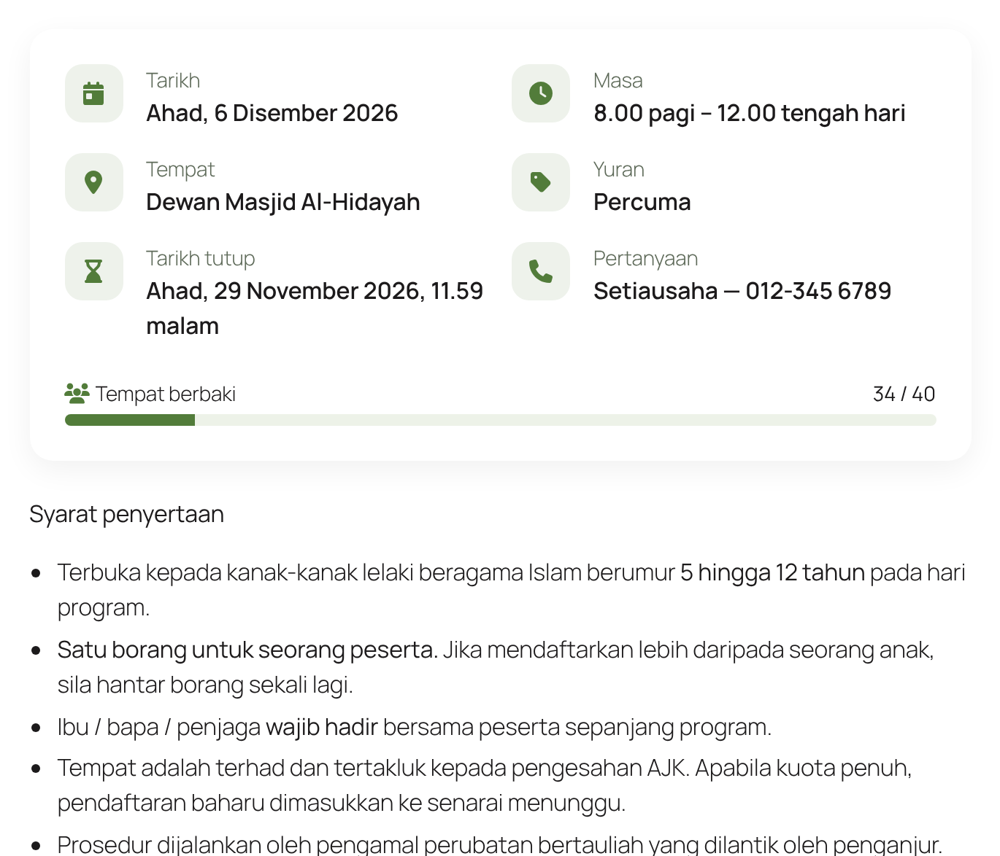

## Ciri-ciri

**Untuk orang awam**
- Kad maklumat program (tarikh, masa, tempat, yuran, tarikh tutup, pertanyaan) dan **bar tempat berbaki**
- Teks pengenalan / syarat di atas borang, medan boleh dua sebaris, ikon setiap bahagian
- Semakan pintar: No. KP / MyKid 12 digit, no. telefon, e-mel, **umur pada tarikh program** (cth. 5–12 tahun), pilihan yang sah
- **Elak pendaftaran berganda** (cth. No. MyKid yang sama) — pemohon diberitahu nombor rujukan sedia ada
- Apabila kuota penuh: tutup pendaftaran **atau** terima ke **senarai menunggu**
- No. rujukan sendiri setiap borang (cth. `KHT-001`) dipaparkan selepas hantar

| Medan borang | Selepas hantar | Telefon |
|---|---|---|
| 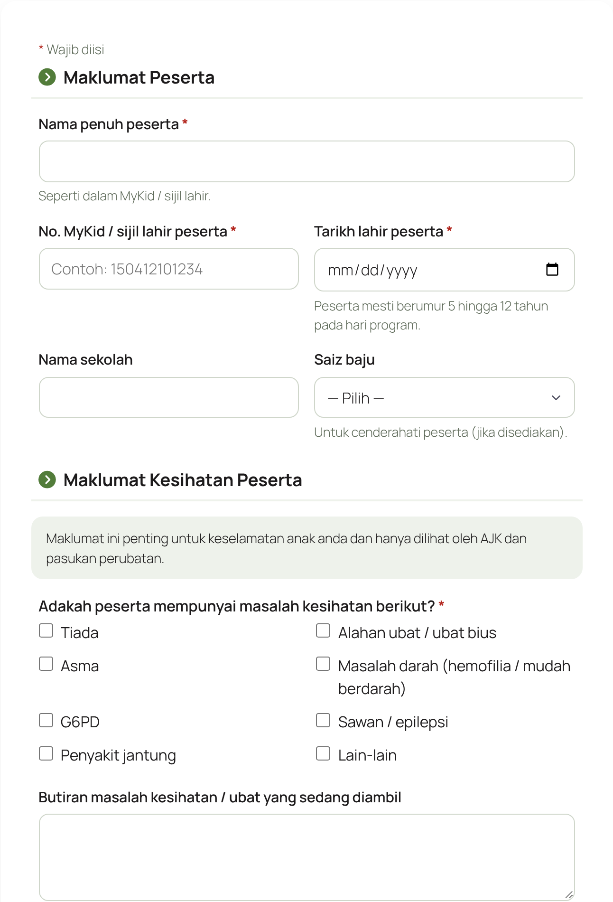 | 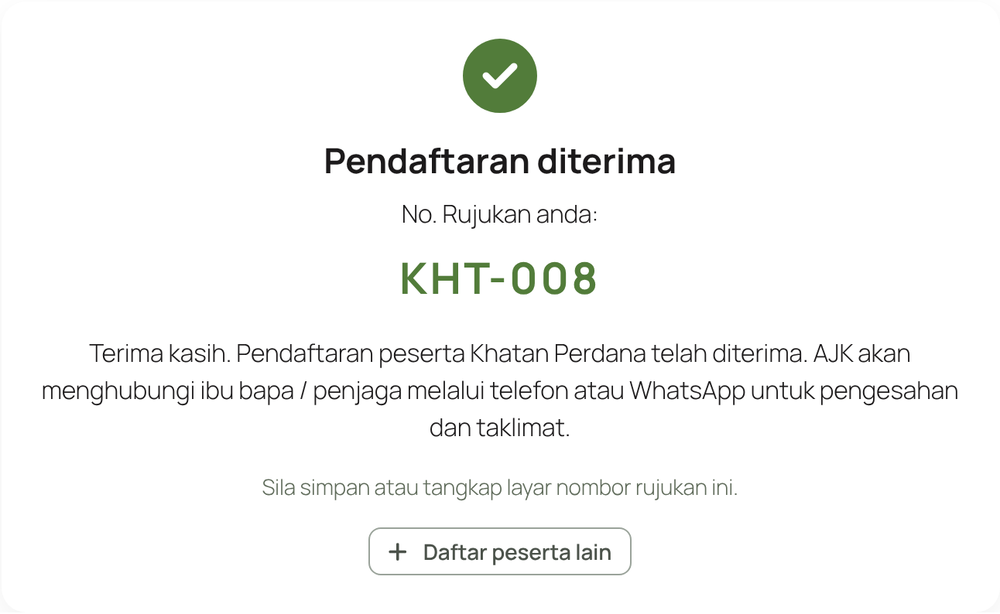 | 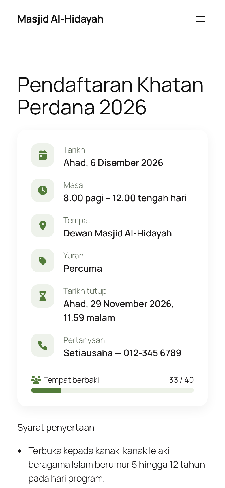 |

**Untuk AJK (wp-admin → Borang Program)**
- **Bina Borang Baharu** dari templat: *Khatan Perdana*, *Program / Kursus / Kelas*, *Sukarelawan / Gotong-royong* atau kosong
- **Pembina medan** seret-dan-lepas — 14 jenis medan: tajuk bahagian, nota, teks pendek/panjang, No. KP/MyKid, telefon, e-mel, nombor, tarikh (dengan had umur), dropdown, radio, kotak semak, muat naik fail (JPG/PNG/PDF), akuan/persetujuan
- **Medan bersyarat** — papar dan wajibkan medan hanya apabila jawapan tertentu dipilih (cth. *muat naik resit bayaran* hanya untuk kategori **Umum — RM100**, bukan Asnaf / Anak Yatim). Borang tidak boleh dihantar tanpa medan itu, dan pelayan turut menyemak
- Tetapan per borang: tarikh dibuka & ditutup, kuota, tindakan apabila penuh, medan unik, awalan no. rujukan, teks butang, mesej selepas hantar
- **Cipta halaman** dengan satu klik (atau shortcode `[borang id="N"]`), **Salin borang** untuk program tahun depan
- **Senarai Pendaftaran**: carian, status *Baharu / Disahkan / Senarai Menunggu / Hadir / Batal*, catatan dalaman, sunting maklumat, pautan WhatsApp, tindakan pukal, **tambah manual** untuk pendaftaran di kaunter
- **Cetak senarai kehadiran** A4 (kolum tandatangan) dan **muat turun CSV** (dibuka terus dalam Excel)
- Pilihan: papar borang yang dibuka sebagai **slaid di laman utama** (bersama plugin [Slaid Utama Masjid](https://github.com/mohdneotech/slaid-masjid))

| Templat | Pembina medan | Maklumat program & tetapan |
|---|---|---|
| 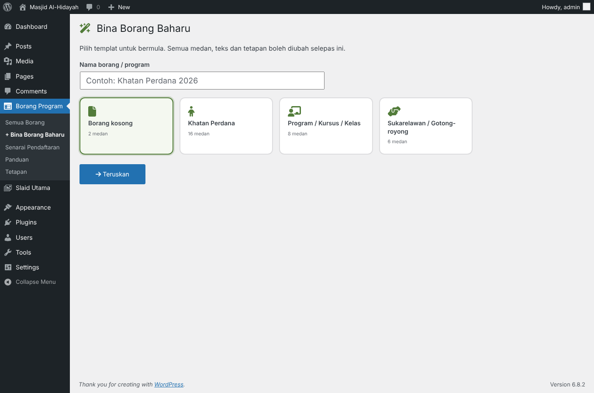 | 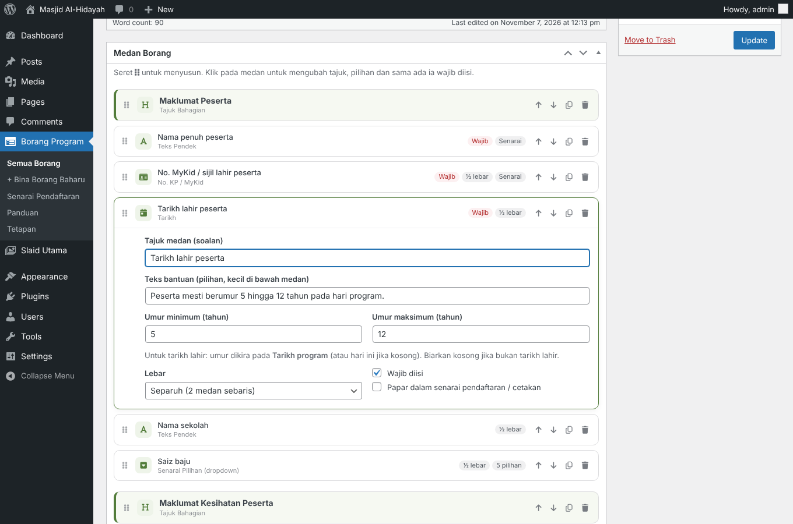 | 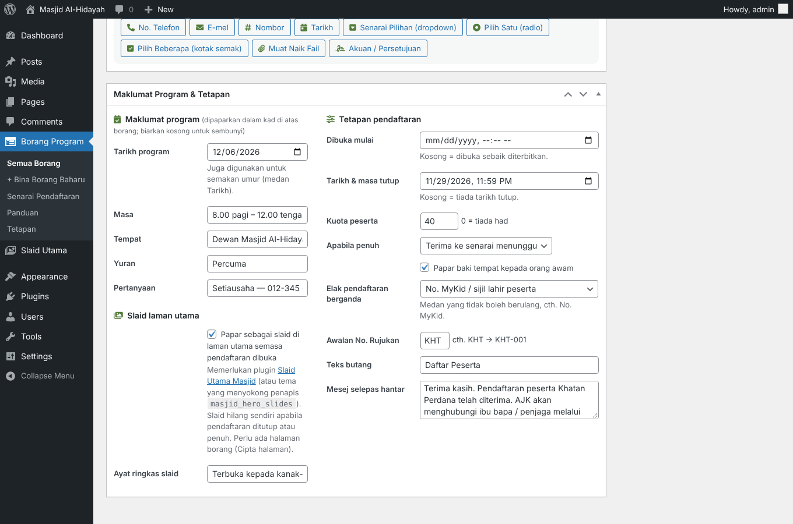 |

| Medan bersyarat — borang awam | Medan bersyarat — tetapan dalam pembina |
|---|---|
| 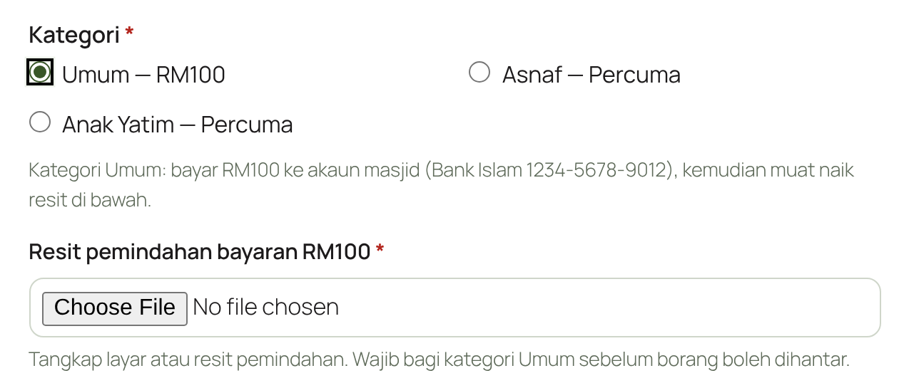 | 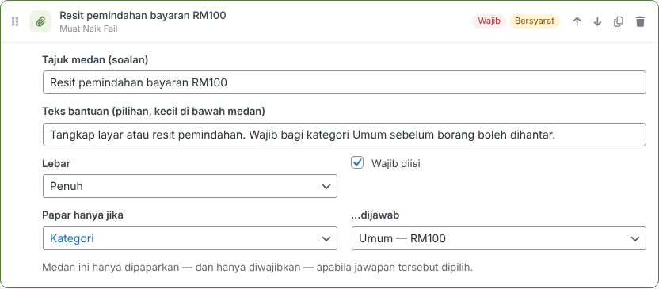 |

| Senarai pendaftaran | Satu pendaftaran | Cetakan |
|---|---|---|
| 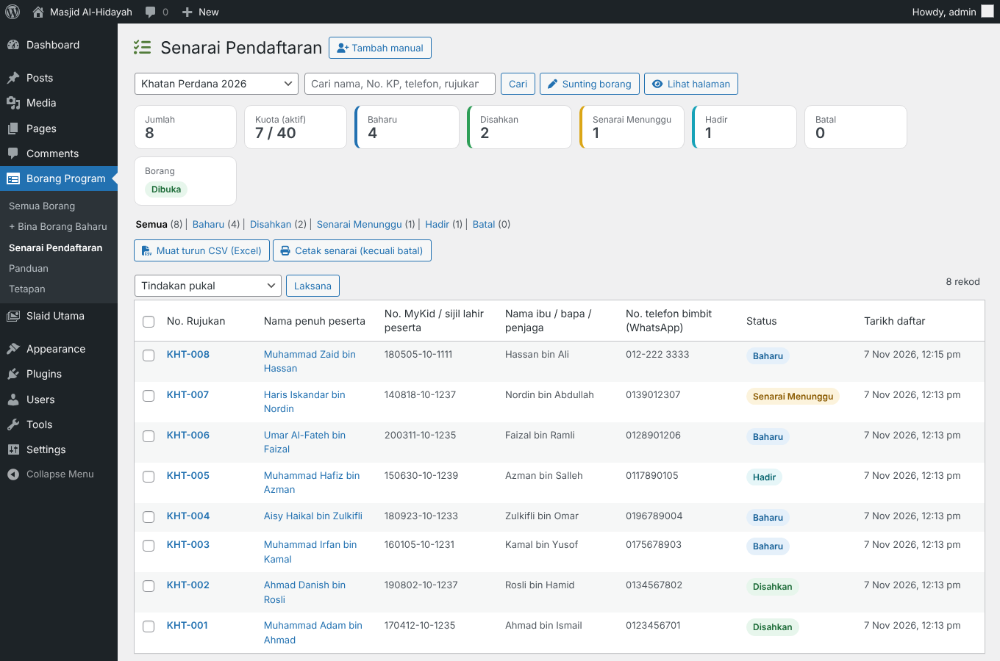 | 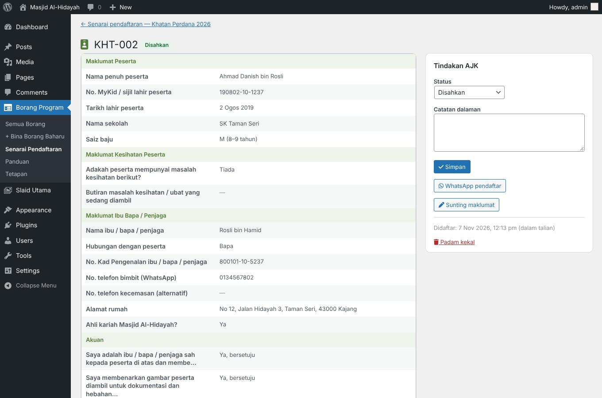 | 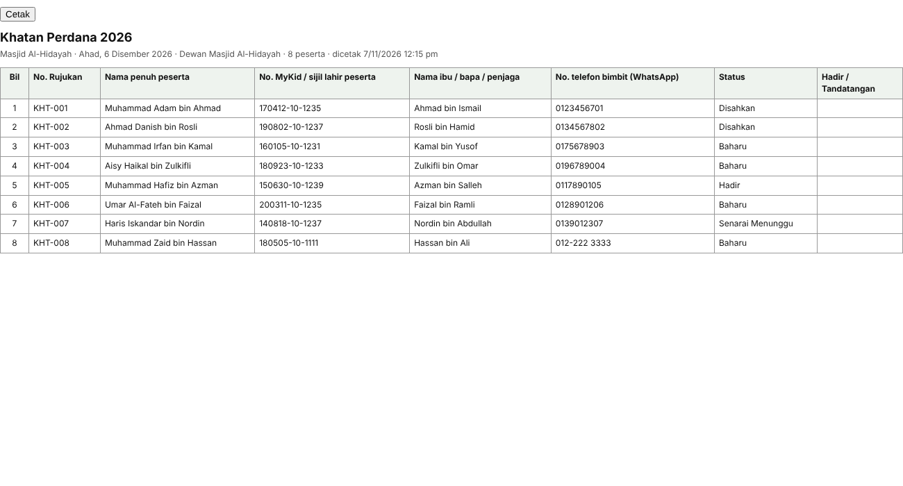 |

**Keselamatan & privasi**
- Fail muat naik disimpan di luar Media Library (`uploads/pb-private/`), disemak kandungannya (bukan sekadar nama fail) dan hanya boleh dibuka oleh AJK yang log masuk
- Nonce, honeypot, masa minimum isi borang dan had penghantaran per IP; alamat IP disimpan sebagai hash sahaja
- Perlindungan formula dalam CSV; mesej status melalui token pelayan
- Hanya peranan dengan keupayaan `pb_urus` (Administrator, Editor, *AJK Kariah* jika ada) boleh melihat pendaftaran; padam kekal hanya untuk Administrator
- Memadam borang turut memadam semua pendaftaran dan failnya

## Pemasangan

1. Muat turun **`borang-masjid.zip`** dari halaman [Releases](../../releases/latest).
2. wp-admin → **Plugins → Add New → Upload Plugin** → pilih zip → **Install Now** → **Activate**.
3. **Borang Program → Tetapan** — isi nama masjid dan pilih warna.
4. **Borang Program → + Bina Borang Baharu** → pilih templat → semak teks, medan dan tetapan → **Terbitkan** → **Cipta halaman**.
5. Salin pautan halaman dan kongsi di WhatsApp / Facebook.

Kemas kini seterusnya muncul di **Dashboard → Updates** seperti plugin biasa.

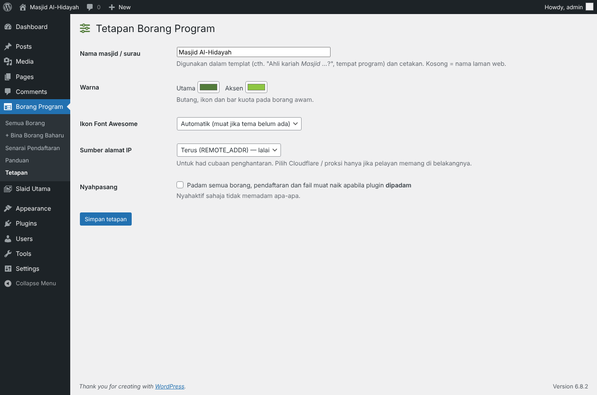

### Shortcode

| Shortcode | Fungsi |
|---|---|
| `[borang id="N"]` | Paparkan borang N (kad maklumat, teks pengenalan, borang) |

### Penapis (untuk pembangun)

| Penapis | Kegunaan |
|---|---|
| `pb_roles` | Peranan yang diberi keupayaan `pb_urus` semasa pengaktifan |
| `masjid_hero_slides` | Slaid hero untuk borang yang ditanda "Papar sebagai slaid" (dibaca oleh Slaid Utama Masjid) |
| `pb_github_updates` | `__return_false` untuk mematikan semakan kemas kini GitHub |

## Penting: nginx

Pada **Apache / LiteSpeed**, folder fail muat naik dilindungi automatik dengan `.htaccess`. Pada **nginx**, tambah:

```nginx
location ^~ /wp-content/uploads/pb-private/ {
    deny all;
    return 403;
}
```

Halaman **Tetapan** memaparkan amaran merah jika folder ini masih boleh diakses.

## Tetapan lain

- **Sumber alamat IP** — pilih *Cloudflare* atau *proksi* hanya jika pelayan memang berada di belakangnya.
- **Font Awesome** — ikon dimuatkan dari jsDelivr (dengan SRI) jika tema belum memuatkannya; boleh dimatikan.
- Plugin ini tidak menghantar e-mel; AJK menyemak pendaftaran baharu di wp-admin.

## Keperluan

WordPress 6.4+ · PHP 8.0+ · MySQL/MariaDB. Diuji pada tema klasik (Bootstrap) dan tema blok **Twenty Twenty-Five**.

Disyorkan: pengesahan dua langkah (2FA) untuk akaun AJK — borang boleh mengumpul No. KP, alamat dan maklumat kesihatan (PDPA). Padam borang lama selepas program jika data tidak lagi diperlukan.

## Menyahpasang

Nyahaktif atau padam plugin **tidak** memadam borang dan pendaftaran secara lalai. Untuk membuang semuanya semasa memadam plugin, tandakan **Tetapan → Nyahpasang** dahulu.

## Berpindah dari binaan khusus (Perepat Borang)

Data dikongsi (`wp_pb_entri`, jenis kandungan `pb_borang`). Nyahaktifkan plugin lama, pasang dan aktifkan plugin ini, kemudian semak **Tetapan**.

## Lesen

GPL-2.0-or-later © Mohd Nordin Hussain
